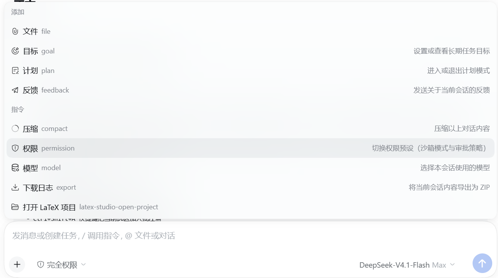
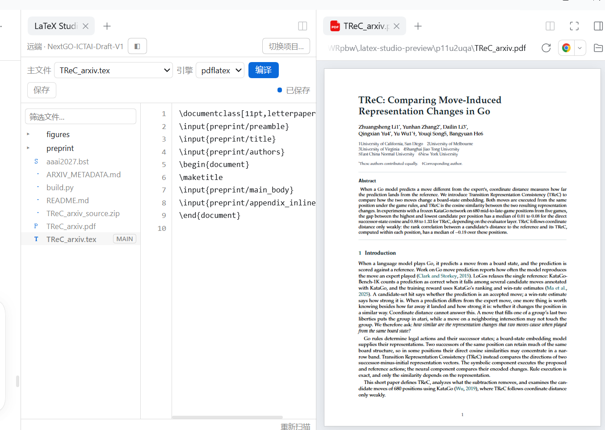
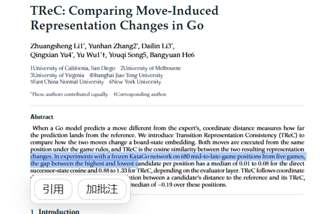
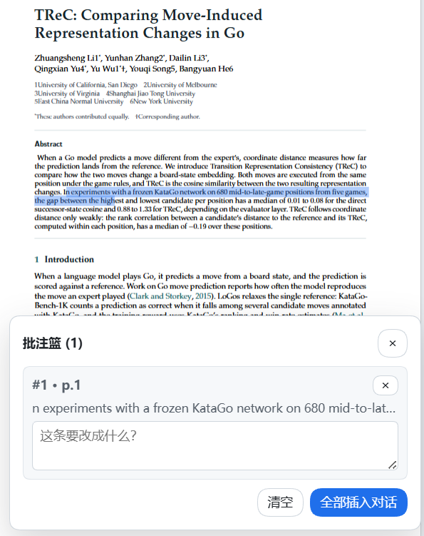

# LaTeX Studio

A project-level LaTeX workspace for DeepSeek Harness. Open a local or SSH
repository as **one project** instead of one file: build the whole paper,
preview the PDF in DSH's native viewer, and quote or annotate passages straight
into the chat — the annotation flow is modelled on Codex.

**English** | [简体中文](README.zh-CN.md)

```bash
dsh plugin --profile desktop add github:Beater-221E/latex-studio
```

---

## Screenshots

| Open a project | Studio: tree, editor, native preview |
|---|---|
|  |  |

| Select text in the PDF | Annotate several passages at once |
|---|---|
|  |  |

## Install

**Requirements** — DSH 0.2.x desktop/web; Node ≥ 22 on the DSH machine; a TeX
distribution on the machine that builds (`pdflatex`/`xelatex`, optional
`bibtex`/`biber`); for SSH workspaces the `dsh-ssh-toolkit` bundle (provides
`sshPool`).

**1. From GitHub (recommended)**

```bash
dsh plugin --profile desktop add github:Beater-221E/latex-studio
```

Pin a version:

```bash
dsh plugin --profile desktop add github:Beater-221E/latex-studio#v0.1.1
```

**2. From a release tarball**

Download `latex-studio-0.1.1.tgz` from the
[Releases](https://github.com/Beater-221E/latex-studio/releases) page, then:

```bash
dsh plugin --profile desktop add ./latex-studio-0.1.1.tgz
```

An HTTP(S) URL works too: `dsh plugin --profile desktop add https://…/latex-studio-0.1.1.tgz`.

**3. Local development (link)**

```bash
git clone https://github.com/Beater-221E/latex-studio.git
dsh plugin --profile desktop add link:./latex-studio
```

**4. Restart and verify**

Fully quit DSH (not just the window) and start it again. Check in
**Settings → Plugins** that the row for the plugin is enabled and active. Open a
session, press **+** in the composer: **Open LaTeX project** should be listed
(the plugin's tab type is also available from the right sidebar guide).

**Upgrade** — repeat the install with a newer tag/tarball (remove first if pnpm
refuses to override):

```bash
dsh plugin --profile desktop remove @local/latex-studio
dsh plugin --profile desktop add github:Beater-221E/latex-studio#v0.2.0
```

**Uninstall**

```bash
dsh plugin --profile desktop remove @local/latex-studio
```

> The plugin package id is `@local/latex-studio`; that is the name to pass to
> `remove` and the row shown in the plugin list.

## Why

Most LaTeX editors compile **the file you opened**. That falls apart for a real
paper: chapter files have no preamble, the bibliography never runs, `\ref`
stays `??`, and figures resolve against the wrong directory.

LaTeX Studio treats a repository as one project: it finds the main `.tex`,
builds in the project root (including `\input`, bibliography and multi-pass
cross-references), shows structured diagnostics, opens the PDF in DSH's native
viewer, and lets you select text there to insert a quote — or several annotated
passages at once — into the composer.

## Features

| Feature | What it does |
|---|---|
| Open any project folder | Local folder (OS dialog) or SSH host folder (in-app browser), **without changing the session workspace** |
| Project discovery | Scans one level for `.tex`, ranks `% !TEX root` and `\documentclass` candidates |
| Whole-project build | `pdflatex` / `xelatex` / `lualatex`; only the bibliography tool the `.aux` asks for; the last pass only when the log reports reruns |
| Skip unchanged | Reuses the existing PDF when no source is newer (“no changes, reused”) |
| Editor | Tree + source pane, `Ctrl+S` save, `Ctrl+Enter` compile |
| Diagnostics | `file:line: message`, missing `.sty`/`.bbl`, undefined references; click to jump |
| Preview | Publishes the build into the workspace and opens DSH's **native PDF.js** preview (selectable text, zoom) |
| Annotations | Codex-style: select text → quote / add to the annotation basket → insert all at once (see below) |
| Local or remote | Spawn locally, or SFTP + `sshPool` remotely, with `remoteWrapper` to hop into a pod |

## Quick start

1. Press **+** in the composer → **Open LaTeX project** (or use the Studio toolbar);
2. Pick *Local folder* or *SSH host*, browse, then **Open project**;
3. The Studio opens: file tree on the left, editor in the middle, main-file selector on top;
4. `Ctrl+S` saves, `Ctrl+Enter` compiles;
5. After a successful build press **Open PDF**; select text and use the floating **Quote** / **Annotate** actions.

## Tutorial

### 1. Opening a project

Two entry points: the composer's **+** menu and the Studio's **Open project /
Switch project**. The dialog offers:

- **Local folder** — opens the OS directory chooser on the DSH machine, or paste
  an absolute path, then **Open project**;
- **SSH host** — choose a host (from `dsh-ssh-toolkit`), press **List**, walk the
  remote tree, then **Open project**.

The session workspace is never changed: the project descriptor is stored per
session in localStorage and every RPC is routed to that folder. Previously
opened projects are remembered and prefilled.

### 2. Choosing the main file

1. A `% !TEX root = main.tex` comment wins outright;
2. Otherwise files with `\documentclass` are scored: the name `main` scores
   highest, `paper`/`ms`/`manuscript`/`thesis`/`report` score less; shallower
   directories, `\begin{document}`, `\title`, and `\input` add points;
3. With several project directories a **Project** dropdown appears first.

For a paper with `main.tex` plus `CameraReady2027.tex`, switch with the **Main
file** dropdown.

### 3. File tree

- Directories expand lazily (one request per level);
- The filter box narrows the current level;
- Type marks: `T` tex, `B` bib, `S` sty/cls/bst, `P` pdf, `I` image, `·` other;
- The open file is highlighted; the main file carries `MAIN`;
- `.tex` opens in the editor; **PDFs and images** open in DSH's native preview
  (the file is first copied to `.latex-studio-preview/<project-hash>/` inside
  the workspace);
- The `◧` button in the project bar collapses the tree.

### 4. Editing

One file at a time, with line numbers. `Ctrl+S` saves (only enabled when dirty),
`Ctrl+Enter` compiles. Switching files with unsaved changes asks for
confirmation.

### 5. Building

1. Runs `<engine> -interaction=nonstopmode -file-line-error -synctex=1 <main>`
   in the **project root**;
2. Reads `.aux` and runs either `biber` or `bibtex` — only the one needed;
3. If the log still reports `Rerun to get` / `Label(s) may have changed` /
   `There were undefined references`, runs one final pass;
4. The status bar reports `errors · warnings · pages · passes · time`.

Two speed-ups:

- **Skip unchanged** — one `find -newer` check; when every `.tex/.bib/.cls/.sty`
  is older than the PDF, TeX is skipped and “no changes, reused” is shown;
- **One remote round trip** — remote builds send the first pass, the
  bibliography tool and the follow-up passes as a single remote command.

### 6. Diagnostics

Errors (`file:line: message`, click to jump), collapsible warnings, missing
files, and a log tail toggle — all parsed from the TeX transcript.

### 7. PDF preview

**Open PDF** opens DSH's built-in document preview: a **native PDF.js viewer**
with a real text layer (text can be selected and copied, zoom works), not a
browser iframe. Because `dsh-resource://file/session/...` resolves against the
session workspace, the PDF is copied to
`.latex-studio-preview/<project-hash>/` first — so two projects with a
`main.pdf` never collide. The button only appears after a successful build.

### 8. Codex-style annotations (key feature)

Goal: mark **several passages** in the PDF, each with its own instruction, and
submit them together — like Codex's PDF annotations.

**Steps**

1. Build and open the PDF preview;
2. Drag-select text in the body; a floating bar appears:

   ```
   [ Quote ] [ Annotate ]
   ```

3. **Annotate** adds `#1 · p.3` (index + page) to a floating basket with a text
   box for “what should change here”;
4. Keep selecting and annotating: `#2 · p.5`, …;
5. **Insert all** turns every annotation into a quote node in the composer, in
   order:

   ```
   [annotation #1 · p.3] selected text…
   request: unify the notation to \bar{x}

   [annotation #2 · p.5] another passage…
   request: replace this figure with a reference plot
   ```

6. Add one summary sentence (“apply all three above”) and send.

**Quote vs Annotate**

| Action | Behaviour | When |
|---|---|---|
| **Quote** | Inserts the selection as one quote node immediately | One passage, one quick request |
| **Annotate** | Adds it to the basket with an index, page and per-item instruction | Several passages to submit together |

**Basket** — item count in the title, per-item text preview, instruction box,
`×` remove, **Clear**, **Insert all**. `×` in the corner only hides the panel.
The basket clears when you switch session or project.

**Shortcut** — `Ctrl+Shift+A` (`Cmd+Shift+A` on macOS) adds the current
selection to the basket without the mouse.

**How it works** — DSH's native preview renders pdf.js text layers, so the
selection is real text. The plugin listens for `selectionchange`, only reacts
inside `.textLayer`, and inserts through the composer's
`inputActions.insertQuote` (the same seam the official `message-quotes` plugin
uses). If a DSH build does not expose it, the text falls back to the clipboard.
Page numbers are inferred from the order of text layers in the preview.

**Compared with Codex**

| Codex annotation | LaTeX Studio |
|---|---|
| Select text → “Ask for changes” | Select text → **Quote** / **Annotate** |
| Numbered notes with screenshots | Numbered notes + page + text (**no screenshots yet**) |
| On-page anchor markers | Not available (the preview belongs to DSH) |
| Same process as the composer | Uses DSH's `insertQuote`; clipboard fallback |
| Submit many at once | **Yes** — basket → Insert all |

### 9. Switching projects

**Switch project…** reopens the dialog. Each project keeps its own preview copy
path, discovery cache and annotation basket. Re-opening a project renders from
cache immediately and refreshes in the background; **Rescan** forces a refresh.

### 10. Workspace vs project directory

A project can live **outside** the session workspace. That does not change the
agent's `bash/read` root — the agent's file tools still see only the workspace.
Preview and annotations use the plugin's own channel. If you want the agent to
edit the paper files directly, open the session at the paper directory instead.

## Remote builds (SSH / pod)

Remote projects reuse `dsh-ssh-toolkit`: files over SFTP, commands through
`sshPool`. When TeX lives in a pod behind the SSH host, use `remoteWrapper`:

```yaml
config:
  remoteWrapper: >-
    bash -c '. /etc/profile.d/dsmlp-login.sh;
    kubectl exec "$(cat ~/.dsmlp/current_pod)" -- bash -c
    "$(printf %s "$1" | sed "s#/dsmlp/home-fs03/<uid>/<gid>/<user>#/home/<user>#g")"' --
```

- The plugin passes the build script as one argument, so `--` and `"$1"` are
  required;
- `bash -c` (not `-l`) on both hops skips the login profiles and saves about
  2.5 s per command on this cluster;
- `sed` maps the login-node home path to the pod's;
- a fixed pod works too: `kubectl exec <pod> -- bash -c …`.

## Configuration

| Field | Default | Meaning |
|---|---|---|
| `engine` | `pdflatex` | Default engine for new projects (switchable in the toolbar) |
| `maxPasses` | `4` | Hard cap on TeX passes per build |
| `timeoutMs` | `180000` | Timeout of one process |
| `remoteWrapper` | empty | Prefix that runs the build script somewhere else |

## FAQ

**`pdflatex: command not found`** — the SSH target has no TeX. Configure
`remoteWrapper`, or use a local project.

**`workspace-file/not-found` when opening the PDF** — the preview copy failed;
the status bar now shows “could not publish the preview: <reason>”. Check that
the workspace is writable, rescan and build again.

**Text cannot be selected in the PDF** — make sure it is DSH's native preview
and the PDF has a text layer (scanned images do not).

**The floating bar does not appear** — select inside the text layer, and make
sure the DSH build exposes the composer interface; otherwise insertion falls
back to the clipboard.

**First open is slow** — the first scan reads file heads; later opens hit the
cache. Remote projects also pay connection setup once.

**Builds feel slow** — remote builds pay one environment hop per build; passes
are already batched and unchanged projects are skipped.

## Limits

- No SyncTeX, no live recompilation, no collaborative editing;
- Annotations are **text only** — region screenshots need a custom renderer and
  an attachment API DSH does not expose to plugins;
- An external project stays invisible to the agent's file tools;
- Discovery scans one level; open deeply nested monorepos at the paper folder;
- Missing TeX packages are reported as diagnostics; install them in the TeX
  distribution (e.g. `mpm --install=...` on MiKTeX).

## Development

```bash
npm test                                            # node --test tests/*.test.mjs
node scripts/service-smoke.mjs <project with main.tex>
```

```
index.js               Host entry: service + Typert binding
client.js              Browser half: tab, dialog, tree, editor, annotations
src/engine.js          Discovery ranking, log parsing
src/build.js           Build loop and batched remote script
src/host/service.js    RPC implementations and project routing
src/host/backends.js   local (fs/spawn) and remote (SFTP/sshPool) backends
src/host/paths.js      Remote workspace placeholder routing
src/host/typert.js     Wire contract
tests/                 Unit tests and the browser registration audit
scripts/service-smoke.mjs  Real-project smoke run
```

## License

MIT
